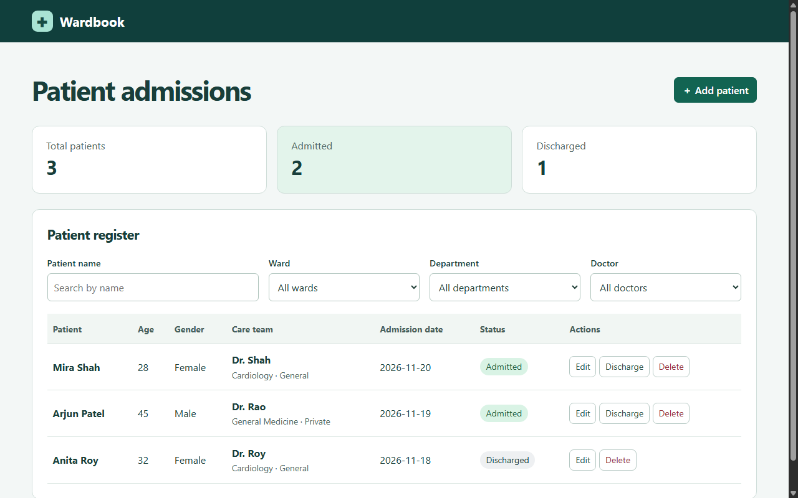
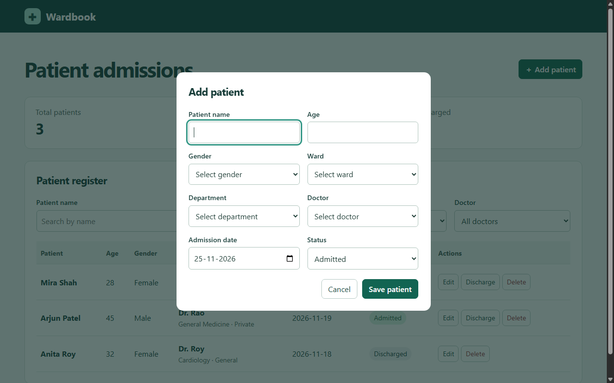

# Wardbook

A small hospital admission register built with React, Java 17 (Spring Boot and JDBC), and Neon PostgreSQL. Staff can add, search, filter, edit, discharge and delete patients. The Java service serves both the React build and the API at one URL.

**Live link** — Pending deployment.

## Run locally

Install Node.js 22, JDK 17 or 21, and Maven 3.9. In PowerShell, open this directory and set the connection details from your Neon dashboard. Use your actual values in the terminal. Keep the password out of source control.

```powershell
$env:DB_URL = "jdbc:postgresql://YOUR-NEON-HOST/YOUR-DATABASE?sslmode=require"
$env:DB_USER = "YOUR-NEON-ROLE"
$env:DB_PASSWORD = Read-Host "Neon password" -MaskInput
cd frontend
npm ci
npm run build
cd ..
mvn package
java -jar target/admissions-1.0.jar
```

Open [localhost on port 8080](http://localhost:8080). The first startup creates the patients table. Use PowerShell 7 for the masked prompt. For live frontend editing, leave Java running, open a second terminal in `frontend` and run `npm run dev`. Open the URL Vite prints.

## Change it during the interview

- **Add a ward or doctor** in `src/main/java/ward/Patient.java`. The form, filters and backend validation all use the same list.
- **Change a field label or input** in `frontend/PatientForm.jsx`. For a validation change, update the matching Java rule and any SQL constraint in `src/main/resources/schema.sql`. Apply database changes to existing tables separately.
- **Change the register, search or actions** in `frontend/src.jsx`. Search and filters work together on the list returned by the API.
- **Change colors or mobile layout** in `frontend/style.css`.
- **Change how records are saved** in `src/main/java/ward/PatientController.java`. SQL parameters carry the field values.

## Deployment

[Deploy this repository to Render](https://render.com/deploy?repo=https://github.com/LIKITHSAIREDDY1/wardbook-patient-admissions). Enter the Neon JDBC URL, role, and password when prompted.

Push this folder as the root of a public GitHub repository. Create a Docker web service from the repository on a Java-capable host. Set the three Neon variables above in the host's secrets settings. The Dockerfile builds React and packages it inside the Java jar. The server uses the host's `PORT` variable or port 8080. Once deployed, test adding and editing a fictional patient and replace the pending live link above. Use fictional records on the public demo.

## Screenshots




